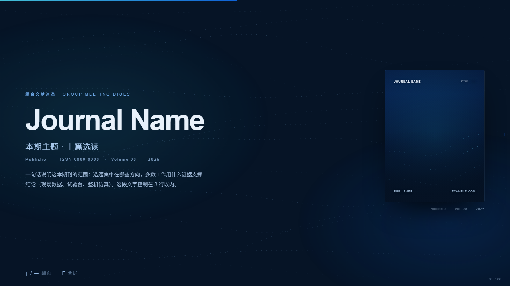
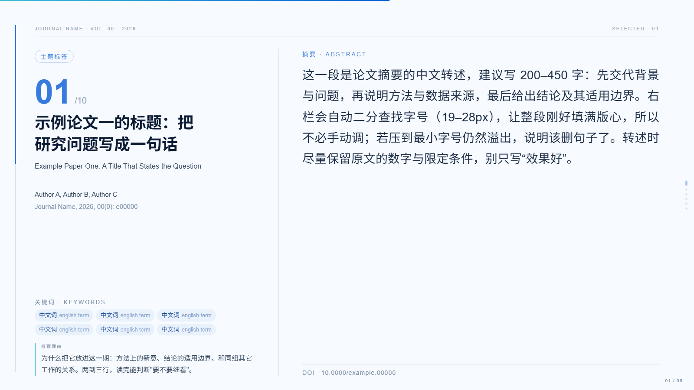
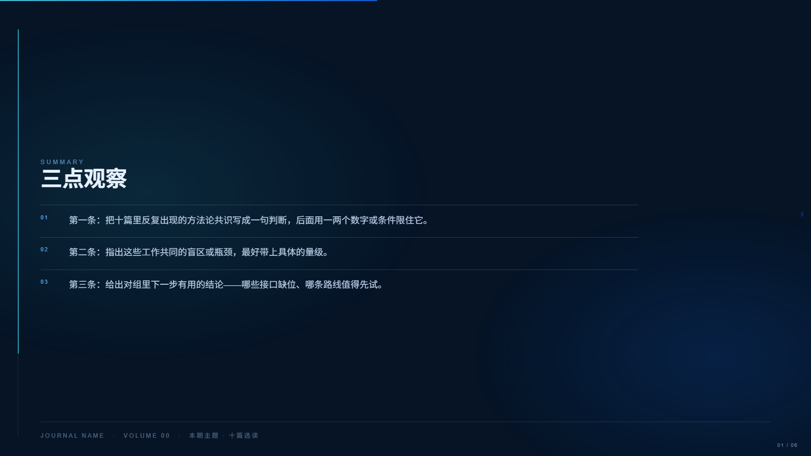

# 组会论文汇报 HTML 演示稿

把「一本期刊的十篇选读」做成**一个可以双击打开的网页 PPT**：深色封面、目录、每篇一页书目卡（中文标题 / 作者出处 / 关键词胶囊 / 推荐理由 / 摘要 / DOI）、三点观察、参考文献。整屏翻页、入场动效、滚动进度条、阅读轨道，全部塞进一个 HTML 文件里——没有构建、没有依赖、离线可用。



## 安装

```bash
npx skills add https://github.com/Nitgomare/group-paper-deck
```

没网或想手动装：把整个仓库拷进 agent 的 skills 目录即可（Claude Code 是 `~/.claude/skills/group-paper-deck/`）。

不需要 skill 机制，只想拿模板：直接下 [`assets/template.html`](assets/template.html)，改文字就能用。

## 直接用

```bash
cp assets/template.html 我的文献汇报.html
open 我的文献汇报.html      # Windows 直接双击
```

模板自带 6 页骨架（封面 / 目录 / 论文页 ×2 / 三点观察 / 参考文献）。**论文页整段复制**就能扩到 10 篇：改标题、作者、关键词、推荐理由、摘要、DOI，再把 `.num` 的 `01/10`、`.dots` 的圆点、`--p` 的百分比一起改。

| 操作 | 键 |
|---|---|
| 翻页 | `↓` `↑` `→` `←` `空格` `PgUp` `PgDn` |
| 首页 / 末页 | `Home` / `End` |
| 全屏 | `F` |
| 跳到第 N 页 | 地址栏加 `#7` |
| 换期刊（双 deck） | 左上角按钮 |



## 它特别在哪

- **摘要自动定字号**：右栏在 19–28px 之间二分搜索，让每段摘要刚好填满版心。十篇长短不一的摘要，翻页时右栏高度是齐的。
- **书目信息的版式**：`.klabel` 的 `margin-top:auto` 把关键词压到左栏底部，与右栏 DOI 对齐成一条基线；`h3.zh` 用 `text-wrap:balance` 让中文标题两行等长。
- **动效克制**：入场是 68ms 错峰 + 单向"读过就留着"，换 deck 沿纵向漂移（因为整套稿子本来就是上下滚的），环境光晕 19 秒呼吸一次。`prefers-reduced-motion` 下全部关闭。
- **单文件便携**：封面照 base64 内联，宽 720px / JPEG q85，整套 300 KB 上下，拷给谁都能开。



## 结构

```
SKILL.md              给 agent 的说明书（何时用、硬规矩、自检）
assets/template.html  唯一交付物：6 页骨架 + 全套 CSS/JS，约 40 KB
references/markup.md  每种页面的标记片段，写新页直接抄
references/motion.md  动效规格、调参表、不要碰的四条
docs/                 预览图
```

## 已知边界

- 论文页一页一篇，适合 8–12 篇；再多建议拆成两个 deck。
- 中文标题超过 39 字、摘要超过 450 字会破版（脚本会在 19px 处停手）。
- 参考文献最多两列 10–12 条。
- 字体走系统栈（Inter / Source Han Sans SC / Microsoft YaHei），不下载 webfont，所以完全离线。

## License

MIT
